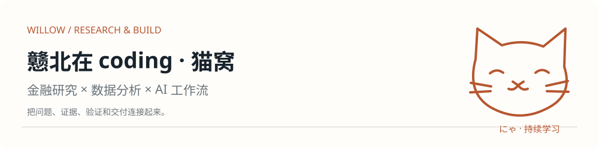
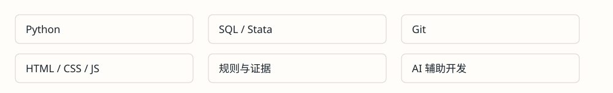

<div align="center">



**nya / nya** · 艾莉丝党 · 在代码与金融之间练爪

[作品集网站](https://willow-tokoton-hitorineko.github.io/research-portfolio/) · [公开 PDF](https://willow-tokoton-hitorineko.github.io/research-portfolio/portfolio-summary.pdf) · [作品集源码](https://github.com/Willow-Tokoton-Hitorineko/research-portfolio)

</div>

## 🐾 ようこそ · 欢迎来到猫窝

我是 Willow，也叫戆北在 coding。这里收录金融研究、数据分析和 AI 工作流作品：先把问题和口径讲清，再让代码、模型与人工复核各司其职。

代码实现有 AI 编程工具参与；本人贡献、验证范围和局限以各仓库说明为准。新发布的方法演示使用合成数据，原始公司系统、业务记录和商业数据库不在公开范围。

## 📦 猫箱 · 从这里看作品

### 已有公开作品

- **[大势罗盘](https://github.com/Willow-Tokoton-Hitorineko/market-compass)**：A 股市场研究工作台，研究计划、取数校验和证据引用分层；不是涨跌预测或买卖建议。
- **[FinDDR · 财小析](https://github.com/Willow-Tokoton-Hitorineko/finddr-fincmini-pipeline)**：跨地区年报规则库与质量门禁归档；团队 Test Set Rank #12，个人贡献在仓库中单独说明。
- **[PolicyScout](https://github.com/Willow-Tokoton-Hitorineko/policyscout)**：政府引导基金政策候选检索、筛选与去重原型，正式核验仍由研究者完成。
- **[FF5 多因子研究](https://github.com/Willow-Tokoton-Hitorineko/ff5-ashare-strategy)**：课程研究归档，保留历史口径与局限；不与新风险预算演示混用结果。
- **[政策文章采集工具](https://github.com/Willow-Tokoton-Hitorineko/debut-wechat-article-crawler)**：早期采集与处理探索，保留为学习记录。

### 独立公开方法演示

- **[稳定币研究方法](https://github.com/Willow-Tokoton-Hitorineko/stablecoin-ecosystem-research)**：企业业务证据、融资关系完整性与分币种汇总；只有合成企业和交易记录。
- **[票据复核工作台](https://github.com/Willow-Tokoton-Hitorineko/invoice-review-workbench)**：规则校验、人工确认、本机网页与安全 CSV 导出；不含原公司代码、OCR 或内部模板。
- **[月频风险预算实验](https://github.com/Willow-Tokoton-Hitorineko/monthly-risk-model-research)**：基准相对倾斜、跟踪误差约束、t+2 收益与漂移成本；合成实验不代表真实收益。
- **[ZIP 中文兼容工具](https://github.com/Willow-Tokoton-Hitorineko/zip-compatibility-tool)**：UTF-8 文件名修复、macOS 元数据清理和 SHA-256 验证，拒绝覆盖已有输出。

各仓库保存具体运行命令和验证记录；[作品集](https://willow-tokoton-hitorineko.github.io/research-portfolio/)提供适合快速浏览的摘要。

## 🔧 猫のツール箱



- **金融研究**：样本资格、字段与时点、风险归因、描述与识别边界。
- **数据与流程**：关系校验、缺失处理、确定性计算、人工确认与导出护栏。
- **工程交付**：离线演示、异常测试、文档与命令核对、脱敏发布。

## 📊 验证记录 · 有证据才记战绩

截至 **2026-10-14**，四个独立方法演示合计 **33 项离线测试通过**，Windows / Linux CI 均通过。它们验证公开演示的行为，不代表原实习系统的准确率或研究的真实收益。

[稳定币 CI](https://github.com/Willow-Tokoton-Hitorineko/stablecoin-ecosystem-research/actions/workflows/verify.yml) · [票据 CI](https://github.com/Willow-Tokoton-Hitorineko/invoice-review-workbench/actions/workflows/verify.yml) · [风险预算 CI](https://github.com/Willow-Tokoton-Hitorineko/monthly-risk-model-research/actions/workflows/verify.yml) · [ZIP CI](https://github.com/Willow-Tokoton-Hitorineko/zip-compatibility-tool/actions/workflows/verify.yml)

大势罗盘的 46 项测试记录见其仓库。日常贡献可直接查看本页下方的 GitHub 原生贡献图；这里不再依赖外部活动统计服务。

## 🐱 猫在追鱼干

<p align="center"><sub>沿贡献格巡游 · GitHub Actions 每日生成；访问本页不会调用模型或金融接口。</sub></p>

<picture>
  <source media="(prefers-color-scheme: dark)" srcset="./output/github-contribution-grid-snake-dark.svg" />
  <source media="(prefers-color-scheme: light)" srcset="./output/github-contribution-grid-snake.svg" />
  
</picture>

[查看生成记录](https://github.com/Willow-Tokoton-Hitorineko/Willow-Tokoton-Hitorineko/actions/workflows/snake.yml)

<details>
<summary>🐾 猫窝小档案 · 点开有猫</summary>

称呼：Willow、猫猫、小蔡。喜欢抹茶、水里游、年糕和红豆；黄瓜、豌豆、哈密瓜暂时不接待。

想学代码（魔法）的野猫，还在练爪。艾莉丝党，ひきこもり大学 · シャリア——这里是个人兴趣表达，不是正式教育或职业资历。

```text
 /\_/\
( ´･ω･)
 | にゃ |
  \___/
```

</details>

---

欢迎来猫窝串门、围观练爪进度。**Thanks for visiting · また遊びに来てにゃ**
