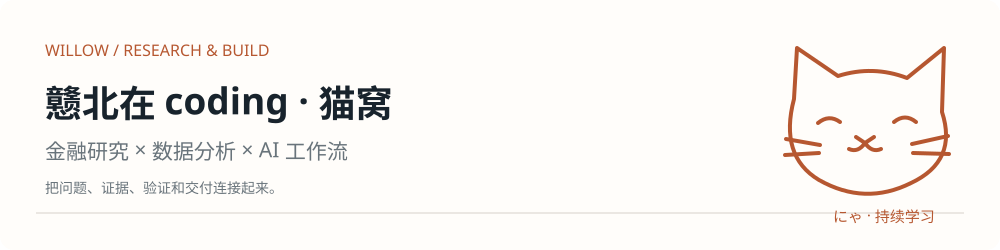

<div align="center">



**nya / nya** · 艾莉丝党 · 在代码与金融之间练爪

[金融作品集](https://willow-tokoton-hitorineko.github.io/research-portfolio/) · [作品集 PDF](https://willow-tokoton-hitorineko.github.io/research-portfolio/portfolio-summary.pdf) · [写作间](https://willow-tokoton-hitorineko.github.io/narrative-studio/)

</div>

## 🐾 ようこそ · 欢迎来到猫窝

我是 Willow，也叫戆北在 coding。猫箱里大多是金融研究和数据工具，最近多了一个写小说的。

### 最近在做 · Narrative Studio 写作间

我想把以前没写完的文章捡起来，就做了个工作台。现在能导入旧稿，圈出一段改写，也能从光标处接着写。最近想先试试长稿导入，看看回到上一次写到的地方要花几步。

[看工作台实录](https://willow-tokoton-hitorineko.github.io/narrative-studio/#film) · [源码与开发进度](https://github.com/Willow-Tokoton-Hitorineko/narrative-studio#开发进度)

## 📦 猫箱

### 研究与产品

- **[大势罗盘](https://github.com/Willow-Tokoton-Hitorineko/market-compass)** · A 股研究工作台。把问题拆成研究计划，沿着数据和出处往下查。
- **[FinDDR · 财小析](https://github.com/Willow-Tokoton-Hitorineko/finddr-fincmini-pipeline)** · 跨地区年报规则与质量检查。团队测试集排名第 12，个人贡献见项目说明。
- **[PolicyScout](https://github.com/Willow-Tokoton-Hitorineko/policyscout)** · 发现政府引导基金制度文本的缺口，整理待核实的政策线索。
- **[稳定币研究方法](https://github.com/Willow-Tokoton-Hitorineko/stablecoin-ecosystem-research)** · 用合成记录演示企业分类、融资关系校验与分币种汇总。
- **[月频风险预算实验](https://github.com/Willow-Tokoton-Hitorineko/monthly-risk-model-research)** · 用合成资产检查跟踪误差、调仓时点和交易成本。

### 日常工具与旧作

- **[票据复核工作台](https://github.com/Willow-Tokoton-Hitorineko/invoice-review-workbench)** · 用合成票据演示规则校验、人工确认和 CSV 导出。
- **[ZIP 中文兼容工具](https://github.com/Willow-Tokoton-Hitorineko/zip-compatibility-tool)** · 修复中文文件名乱码，清理 macOS 附带文件，并逐个验证 SHA-256。
- **[FF5 多因子研究](https://github.com/Willow-Tokoton-Hitorineko/ff5-ashare-strategy)** · 课程研究归档。回测发现同期间信息偏差，收益仍待重算。
- **[微信文章采集实验](https://github.com/Willow-Tokoton-Hitorineko/debut-wechat-article-crawler)** · 早期的 Python 与 Playwright 练习。

[按关键词查找金融作品](https://willow-tokoton-hitorineko.github.io/research-portfolio/#projects) · [作品集源码](https://github.com/Willow-Tokoton-Hitorineko/research-portfolio)

<details>
<summary>测试记录与数据说明</summary>

截至 2026-10-14，稳定币、票据、风险预算和 ZIP 四个演示合计通过 36 项离线测试，Windows 与 Linux 均通过。大势罗盘另有 46 项隔离测试，详见项目仓库。

[稳定币 CI](https://github.com/Willow-Tokoton-Hitorineko/stablecoin-ecosystem-research/actions/workflows/verify.yml) · [票据 CI](https://github.com/Willow-Tokoton-Hitorineko/invoice-review-workbench/actions/workflows/verify.yml) · [风险预算 CI](https://github.com/Willow-Tokoton-Hitorineko/monthly-risk-model-research/actions/workflows/verify.yml) · [ZIP CI](https://github.com/Willow-Tokoton-Hitorineko/zip-compatibility-tool/actions/workflows/verify.yml)

公开演示用合成数据。各项目的贡献、数据出处与验证口径写在对应仓库。

</details>

## 🐱 猫在追鱼干

<picture>
  <source media="(prefers-color-scheme: dark)" srcset="./output/github-contribution-grid-snake-dark.svg" />
  <source media="(prefers-color-scheme: light)" srcset="./output/github-contribution-grid-snake.svg" />
  
</picture>

[查看生成记录](https://github.com/Willow-Tokoton-Hitorineko/Willow-Tokoton-Hitorineko/actions/workflows/snake.yml)

<details>
<summary>🐾 猫窝小档案</summary>

可以叫我 Willow，也可以叫猫猫。喜欢抹茶、游泳、年糕和红豆。黄瓜、豌豆和哈密瓜暂不接待。

ひきこもり大学 · シャリア是猫窝设定。

```text
 /\_/\
( ´･ω･)
 | にゃ |
  \___/
```

</details>

また遊びに来てにゃ。
